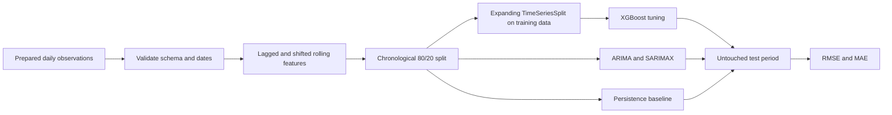

# Smart Water Management - Time-Series Forecasting

A reproducible forecasting study of Bilancino Lake water level and flow rate using 18 years of prepared daily hydrological observations. The project compares a persistence baseline with XGBoost, ARIMA, and SARIMAX under chronological evaluation.

The public version was rebuilt to prevent target leakage: every forecasting feature is shifted, model selection uses expanding time-series folds, and the final 20% of observations is held out in chronological order.

## Problem

Reliable lake-level and flow forecasts can support water-resource planning, drought monitoring, and operational decision-making. This project investigates two targets:

- `Actual_Lake_Level`
- `Actual_Flow_Rate`

The prepared dataset contains 6,603 daily observations from June 3, 2002 through June 30, 2020, together with rainfall and temperature measurements.

## Evaluation design



Leakage controls:

- Only measurements from `t-1` or earlier are used to predict time `t`.
- Rolling statistics are calculated after a one-step shift.
- The test set is the final 20% of the timeline; data is never shuffled.
- XGBoost hyperparameters are selected with `TimeSeriesSplit`, not random K-fold validation.
- The persistence forecast (`y[t-1]`) is reported so learned models must beat a meaningful baseline.

## Verified results

The results below were regenerated from the included script. The test period contains 1,315 observations from November 24, 2016 through June 30, 2020.

### Lake-level forecasting

| Model | RMSE | MAE |
|---|---:|---:|
| Persistence baseline | 1.127 | 0.717 |
| **XGBoost** | **0.900** | **0.683** |
| ARIMA(5,1,0) | 1.518 | 1.292 |
| SARIMAX(5,1,0) | 1.524 | 1.293 |

XGBoost reduced RMSE by approximately 20.2% relative to persistence on the held-out period. Its selected parameters were 150 estimators, depth 3, learning rate 0.03, and subsample 0.8.

### Flow-rate forecasting

| Model | RMSE | MAE |
|---|---:|---:|
| **Persistence baseline** | **2.085** | **0.947** |
| XGBoost | 2.114 | 1.017 |
| ARIMA(5,1,0) | 3.516 | 1.652 |
| SARIMAX(5,1,0) | 3.550 | 1.669 |

None of the learned models beat persistence for flow rate. This negative result is retained because it shows that the available lagged variables do not reliably anticipate abrupt flow spikes; additional upstream, precipitation-forecast, or operational-release signals may be required.

Complete machine-readable results are available in [`results/metrics.json`](results/metrics.json).

## Repository structure

```text
.
├── data/
│   └── README.md          # Dataset source, schema, and placement
├── results/
│   ├── metrics.json
│   └── README.md
├── src/
│   └── evaluate.py        # Leakage-safe feature engineering and evaluation
├── .gitignore
├── requirements.txt
└── README.md
```

## Installation

```bash
git clone https://github.com/Hamidreza4p/smart-water-management-forecasting.git
cd smart-water-management-forecasting

python -m venv .venv
```

Activate the environment:

```bash
# Linux/macOS
source .venv/bin/activate

# Windows PowerShell
.\.venv\Scripts\Activate.ps1
```

Install dependencies:

```bash
python -m pip install --upgrade pip
pip install -r requirements.txt
```

## Data setup

Download the Bilancino Lake data from the [Acea Smart Water Analytics competition](https://www.kaggle.com/competitions/acea-water-prediction/data) according to Kaggle's access terms.

Place the prepared five-column file at:

```text
data/lakes_fe.csv
```

See [`data/README.md`](data/README.md) for the required schema. The CSV is intentionally excluded from Git because its redistribution rights are governed by the source dataset's terms.

## Run the evaluation

```bash
python src/evaluate.py --data data/lakes_fe.csv --output results
```

This regenerates `metrics.json` and both forecast plots.

## Current limitations

- Results apply to the supplied prepared dataset and may not transfer to other lakes or operating regimes.
- The evaluation is a fixed chronological holdout, not rolling-origin backtesting with repeated model refits.
- SARIMAX uses lagged rainfall, temperature, and the other hydrological target as exogenous variables.
- The verified public pipeline does not report the earlier notebook's LSTM results because its preprocessing fitted scalers before the temporal split.
- The prepared dataset contains smoothed or repeated stretches; the upstream feature-preparation process should be documented further for full raw-data reproducibility.

## Author

Developed by **Hamidreza Sadeghzadeh**.

Dataset source: [Acea Smart Water Analytics](https://www.kaggle.com/competitions/acea-water-prediction/data).

